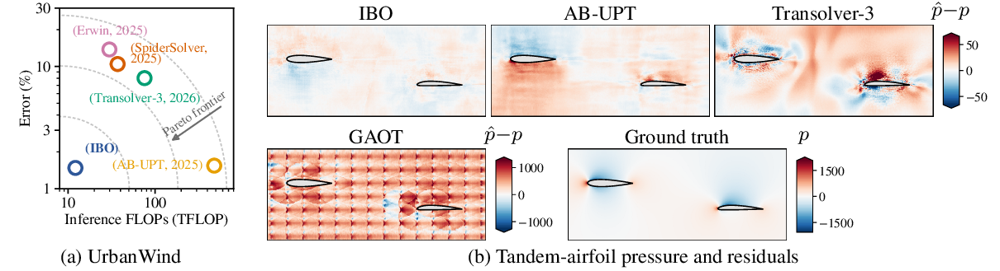
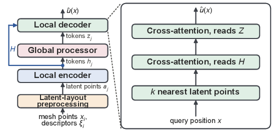
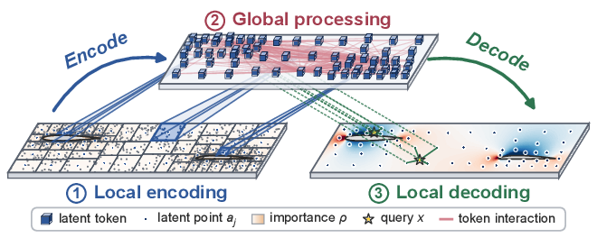
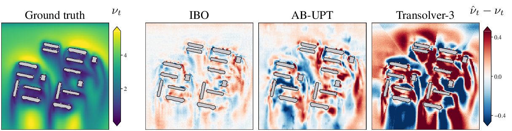
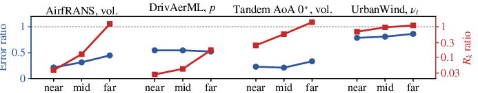
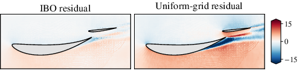
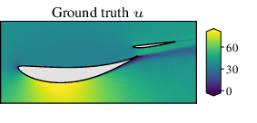
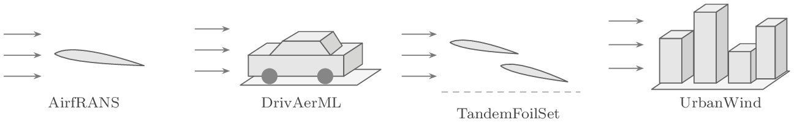

# IBO: Importance-Balanced Operator

Code for **Seeing Near and Far: A Neural Operator That Efficiently Tokenizes and Decodes on Industrial-Scale CFD Meshes** (preprint, 2026).

IBO is a neural operator for CFD meshes with up to 10^8 points. It partitions each case's points with a KD-tree under an importance measure, so that every latent point summarises the same importance mass, processes the latent points globally, and decodes every query point from its *k* nearest latent points. The full-field inference cost is paid once per case plus a per-point term that does not grow with the mesh size.



*(a) UrbanWind: geometric-mean relative L2 error of the six fields against inference FLOPs per case; dashed curves are illustrative iso-utility contours. (b) Pressure of a tandem-airfoil case and the residuals of several neural operators.*

This repository contains the model, the five baselines reproduced in the paper, and the preprocessing, training and evaluation code for the four benchmarks, behind one command line.

## Method




*(a) The IBO architecture. (b) Leaves of equal importance mass define latent points at positions a_j (1), which interact globally (2); each query is decoded from its k nearest latent points (3).*

- **Latent layout.** The input points of a case are split by an equal-count KD-tree in the importance measure: at every level a region is halved along its widest axis at the median of the cumulative weight. With unit weights (AirfRANS, TandemFoilSet, DrivAerML) every region holds the same number of points; UrbanWind weights the volume points by the inverse square root of their distance to the nearest building (floored at 2 m), so near-wall regions are smaller. The leaves of the tree are the latent points, placed at the (importance-weighted) mean position of their members; the uniform-grid layout of the ablation places them at cell centres.
- **Encoder.** Each latent point reads a capped set of member points through a small PointNet with max, mean and standard-deviation pooling, concatenated with a region descriptor (position, wall distances and directions, further geometric statistics) and projected to the token width.
- **Processor.** A pre-norm transformer with rotary position embeddings over the latent-point coordinates; optional registers, gated long skips and a case-condition modulation.
- **Decoder.** Every query point attends to its *k* nearest latent points through one or two cross-attention stages, with a learned inverse-distance prior on the attention scores and a pair embedding of the normalised offsets; volume and surface queries enter through separate first layers of the self-embedding and one output head emits the fields.
- **Training and inference.** Each step draws a fixed number of query points per case; inference encodes a case once and decodes all its points in fixed-size chunks through the same code path.

Section 3 and Appendix B of the paper define the operator; Appendix C.2 lists the per-benchmark settings, which are the files under `configs/`.

## Results

The tables repeat the paper's main tables (means over the training seeds of Appendix C.4). Rows marked † are our reproductions; rows marked ‡ are reproductions published by the cited works; unmarked baseline rows are the values reported by their own papers.

**AirfRANS** (standardized field MSE, lift relative error and lift Spearman correlation over the 200 test cases):

| Model | Volume ↓ | Surface ↓ | C_L ↓ | ρ_L ↑ |
|---|---|---|---|---|
| GINO ‡ | 0.0297 | 0.0482 | 0.1821 | 0.9958 |
| Transolver | 0.0037 | 0.0142 | 0.1030 | 0.9978 |
| SpiderSolver | 0.0017 | 0.0043 | 0.0741 | 0.9988 |
| AB-UPT † | 0.0022 | 0.0011 | 0.0470 | 0.9996 |
| IBO (ours) | **0.0009** | **0.0006** | **0.0146** | **0.9999** |

‡ GINO as reproduced by Transolver (Wu et al., 2024); the Transolver and SpiderSolver rows are the values reported by Wu et al. (2024) and Qi et al. (2025).

**DrivAerML** (relative L2 field error in %, coefficient R² over the 50 test cases, and the analytic full-mesh inference cost in PFLOP per case):

| Model | p_s ↓ | τ ↓ | p ↓ | U ↓ | C_D R² ↑ | C_L R² ↑ | PFLOP ↓ |
|---|---|---|---|---|---|---|---|
| GINO ‡ | 13.03 | 21.71 | 44.90 | 40.58 | – | – | – |
| GAOT ‡ | 34.00 | 61.00 | 56.90 | 57.18 | – | – | – |
| Transolver-3 | **3.71** | **5.85** | 5.72 | **4.14** | **0.972** | **0.985** | 25.3 |
| AB-UPT | 3.82 | 7.29 | 6.08 | 5.93 | 0.963 | 0.975 | 22.2 |
| IBO (ours) | 3.78 | 7.12 | **3.44** | 5.14 | 0.967 | 0.980 | **2.6** |

‡ GINO as reproduced by AB-UPT (Alkin et al., 2025) and GAOT as reproduced by Transolver-3 (Zhou et al., 2026); the Transolver-3 and AB-UPT rows are the values reported by Zhou et al. (2026) and Alkin et al. (2025), under their own evaluation protocols and training budgets.

**UrbanWind** (relative L2 errors in physical units over the 160 test cases and full-field inference costs; all baselines are our reproductions):

| Model | U_x | U_y | U_z | p | ν_t | p_s | Latency (s) | Inference (TFLOP) |
|---|---|---|---|---|---|---|---|---|
| SpiderSolver | 0.9145 | 0.1571 | 0.8192 | 0.0073 | 0.1886 | 0.0081 | 19.697 | 37.12 |
| Erwin | 0.6359 | 0.1246 | 0.6093 | 0.0146 | 0.3767 | 0.0256 | 15.538 | 29.85 |
| Transolver-3 | 0.5811 | 0.0954 | 0.5678 | 0.0070 | 0.1263 | 0.0096 | 1.771 | 75.70 |
| AB-UPT | 0.1365 | 0.0222 | 0.1448 | 0.0006 | 0.0427 | **0.0012** | 3.246 | 479.50 |
| IBO (ours) | **0.1267** | **0.0199** | **0.1335** | **0.0004** | **0.0337** | 0.0023 | **0.364** | **12.14** |

**TandemFoilSet** (standardized volume and surface MSE on the five subsets; all baselines are our reproductions; costs per full-field prediction):

| Model | AoA 0° Vol. | AoA 0° Surf. | AoA 5° Vol. | AoA 5° Surf. | Random Vol. | Random Surf. | Race Car Vol. | Race Car Surf. | Takeoff Vol. | Takeoff Surf. | Latency (s) | Inference (TFLOP) |
|---|---|---|---|---|---|---|---|---|---|---|---|---|
| GAOT | 0.3779 | 1.5488 | 0.3785 | 1.4200 | 0.6327 | 1.5234 | 0.3930 | 0.4560 | 0.5079 | 1.4007 | **0.071** | **0.57** |
| Erwin | 0.1233 | 0.5268 | 0.0395 | 0.2480 | 0.3135 | 1.0371 | 0.8817 | 2.5598 | 0.0930 | 0.5230 | 1.196 | 1.15 |
| SpiderSolver | 0.7446 | 0.5348 | 0.7726 | 0.8465 | 0.0165 | 0.0140 | 0.0335 | 0.0232 | 0.5141 | 0.3794 | 1.582 | 3.00 |
| Transolver-3 | 0.0031 | 0.0031 | 0.0032 | 0.0044 | 0.0214 | 0.0139 | 0.0292 | 0.0171 | 0.0027 | 0.0033 | 0.211 | 2.82 |
| AB-UPT | **0.0001** | 0.0015 | **0.0003** | 0.0022 | 0.0021 | 0.0037 | 0.0141 | 0.0209 | **0.0002** | 0.0013 | 0.129 | 12.49 |
| IBO (ours) | **0.0001** | **0.0009** | **0.0003** | **0.0020** | **0.0006** | **0.0027** | **0.0132** | **0.0141** | **0.0002** | **0.0009** | 0.396 | 3.97 |



*Turbulent viscosity and prediction residuals in an UrbanWind case.*

**Layout ablation** (metrics as above; the importance weight applies only to UrbanWind):

| Latent layout | AirfRANS Vol. | AirfRANS Surf. | AirfRANS C_L | AirfRANS ρ_L | DrivAerML p_s | DrivAerML τ | DrivAerML p | DrivAerML U | DrivAerML C_D R² | DrivAerML C_L R² |
|---|---|---|---|---|---|---|---|---|---|---|
| Uniform grid | 0.0026 | 0.0050 | 0.0318 | 0.9996 | 8.74 | 12.70 | 6.37 | 8.25 | 0.823 | 0.666 |
| Adaptive, equal count | **0.0009** | **0.0006** | **0.0146** | **0.9999** | **3.78** | **7.12** | **3.44** | **5.14** | **0.967** | **0.980** |
| Adaptive, ½ token number | **0.0009** | **0.0006** | 0.0168 | 0.9998 | 3.93 | 7.38 | 3.52 | 5.26 | 0.954 | 0.978 |

| Latent layout | AoA 0° Vol. | AoA 0° Surf. | AoA 5° Vol. | AoA 5° Surf. | UrbanWind U_x | UrbanWind U_y | UrbanWind U_z | UrbanWind p | UrbanWind ν_t | UrbanWind p_s |
|---|---|---|---|---|---|---|---|---|---|---|
| Uniform grid | 0.0005 | 0.0099 | 0.0006 | 0.0075 | 0.1785 | 0.0272 | 0.1868 | 0.0007 | 0.0410 | 0.0029 |
| Adaptive, equal count | **0.0001** | **0.0009** | **0.0003** | **0.0020** | 0.1429 | 0.0222 | 0.1498 | 0.0005 | 0.0360 | 0.0027 |
| Adaptive, importance-weighted | / | / | / | / | **0.1267** | **0.0199** | **0.1335** | **0.0004** | **0.0337** | **0.0023** |

The uniform-grid rows are `--layout grid`; the equal-count rows are `--layout equal` on UrbanWind and the default (`importance`, with unit weights) elsewhere. The half-token rows halve `n_leaves` of the dataset's preprocess section and `ibo.n_tokens` (a separate cache).





*At the same token budget, IBO lowers the error at every wall distance. Top: IBO-to-uniform-grid ratios over equal-count wall-distance thirds; the R_k ratio (red) is the mean distance from a query to its k latent points, the error ratio (blue) stays below one in every third. Middle: u residuals on a TandemFoilSet Race Car case, where the uniform grid's error concentrates in the gap and the wakes. Bottom: ground-truth u.* `tools/wall_distance_bins.py` computes the UrbanWind bins from an evaluated run.

## Datasets



The code assumes the raw data are already on disk; nothing is downloaded. Default locations are `data/<dataset>` for raw data and `cache/<dataset>` for the preprocessed cache (`--data-root`, `--cache-root`). The splits used in the paper are files of this repository.

**AirfRANS** (Bonnet et al., 2022). 1,000 steady RANS cases of two-dimensional flow around NACA airfoils (k-ω SST, Re = 2–6×10^6, kinematic pressure), about 10^5 nodes per case on a body-fitted mesh cropped to (-2, 4) × (-1.5, 1.5) m. Raw input: the contents of the official `Dataset/` directory (`<case>/<case>_internal.vtu`, `<case>/<case>_aerofoil.vtp` and the official `manifest.json`) at `data/airfrans`; evaluation reads the raw files again for the lift integration, so the same `--data-root` is needed there. Split: the official full task, 800 train / 200 test; 80 of the 800 become the validation split with a fixed seed (720 / 80 / 200, written to the cache). Preprocessing: per case, the signed distance to the airfoil polygon and its gradient at every node (the outward normal on the wall), an eight-sector directional distance profile capped at two chords, a curvature proxy (circular variance of the wall-direction angles among eight neighbours), one equal-count tree of 4,096 leaves over all nodes, up to 25 members per leaf with 15 features, the leaf-level distance fields, the 8 nearest leaves of every node; train-split z-scores for the targets (u_x, u_y, p, ν_t; the surface target is p), the inflow (U cos α, U sin α) and the features, and a 5th/95th-percentile affine for coordinates; a calibration report fixes the rotary domain and the Fourier distance scale, adopted at launch. Evaluation decodes every node; lift and drag are integrated with the dataset's own pyvista procedure.

**TandemFoilSet** (Lim et al., 2026). Two-dimensional steady flow over tandem airfoils (OpenFOAM, k-ω SST, overset meshes, kinematic pressure); we use the five tandem subsets Cruise AoA 0°, Cruise AoA 5°, Cruise Random, Takeoff and Race Car, each its own benchmark. Raw input: the dataset's Part pickles (`*_ive_*Part*.pickle`, loaded with `torch.load`), each a list of case dictionaries with `pos`, `boundary` (5 = front airfoil, 6 = rear), `edge_index`, `y` = (u, v, p), `flowState` (Umag, Re, nu) and `AoA`. Split: 8:1:1 per subset with a fixed seed after the data-quality gate (`datasets/tandemfoilset/splits.json`); cases whose maximum pressure coefficient exceeds 1.1 in the steady regime (Re ≥ 10^4) are dropped, which removes 11 Race Car cases. Preprocessing per subset: the two airfoil polygons chained from the mesh connectivity, the signed distance and gradient to each airfoil, the two-body directional distance profile (eight sectors, capped at five chords, blended toward the nearer body), the curvature proxy, an equal-count tree of 4,096 leaves with a member cap equal to the subset's mean occupancy and 18 slot features, the 8 nearest leaves; velocity is divided by the inflow speed and pressure by its square before the train-split z-score, the condition is (Umag, AoA) z-scored, coordinates use the percentile affine; the calibration report per subset sets the rotary domain and the Fourier scale. The reported MSE is computed on the physical fields standardized with the training-split statistics of the raw fields: the volume error averages (u, v, p) over all volume nodes, the surface error is p over the wall nodes.

**DrivAerML** (Ashton et al., 2024). Hybrid RANS-LES over 500 morphs of the DrivAer car, 484 with simulations, about 1.4×10^8 volume and 8.8×10^6 surface cells per case; CC BY-SA 4.0. Raw input: one `run_<id>.pt` dictionary per case with `volume_coords`, `volume_velocity`, `volume_pressure`, `volume_nut`, `surface_coords`, `surface_pressure`, `surface_wallshearstress`, `surface_normal`, `surface_area`, `stl_vertices`, `stl_faces` and `reference` (a nested block holding `aRef`, `Cd` and `Cl`); converting the released VTK files into this layout is left to the user. Split: AB-UPT's 400 / 34 / 50 (`datasets/drivaerml/splits.json`). Preprocessing per case: the surface normals are oriented by integrating the reference drag and lift; the volume is cropped to [-30, 60] × [-8, 8] × [-0.5, 8] m and coordinates are divided by 10; one equal-count tree over the cropped volume and the whole surface with 15 region levels (32,768 latent points) and 7 subregion levels (128 per region); subregion centroids with surface fraction, signed wall distance and wall direction (Open3D ray casting on the STL) are the 8 slot features; the training query pool is one volume point per subregion (2^22) plus up to five million surface points, the held-out pool is up to five million volume points plus every surface point; the 16 nearest latent points of every pooled point are stored. Targets are z-scored with train-split statistics (the model predicts U_x, U_y, U_z, p and the surface p, τ_x, τ_y, τ_z); the loss averages the eight channels. Field errors are relative L2 in physical units, jointly over the components of U and τ; drag and lift are integrated over the complete surface with the face areas.

**UrbanWind** (this paper, CC BY-SA 4.0). Steady RANS over 480 residential estates with four wind directions each, in a frame where the mean wind blows toward -y. Raw input: one `<estate>_<dir>.pt` dictionary per case with `volume_pos`, `volume_fields` (U_x, U_y, U_z, p, ν_t), `surface_pos`, `surface_fields` (p, τ_x, τ_y, τ_z), `surface_normals`, `volume_sdf` and `volume_sdf_grad`. Split: 400 / 40 / 40 estates (`datasets/urbanwind/splits.json`), every direction of an estate in the same split, 160 test cases. Preprocessing: building footprints are extracted from the wall points by DBSCAN clustering and concave-hull simplification and extruded through their height intervals; per point the distances to wall faces and roofs, blended edge and corner directions, six axis-aligned ray distances to the nearest building (capped at 550 m), and categorical codes (point type, geometric region or face orientation, surface-edge type with wind group); the volume partition uses the wall-distance weight max(s, 2 m)^(-1/2) with 16,384 leaves, surface points are attached afterwards to the nearest leaf with a free slot and take the first of the 32 member slots; 19 regional statistics form the region descriptor; five morphology scalars condition the processor. A logarithmic reference profile is removed from U_y and 9.81 z is added to the pressures before the z-score, with the paper's constants in `datasets/urbanwind/norm_stats.json`. The geometry of an estate is stored once and the four directions are rigid rotations of it.

## Installation

Python 3.10+ and PyTorch 2.4+ with CUDA. Install the package requirements, then the optional dependencies of the datasets you use:

```bash
pip install -r requirements.txt
```

| Needed for | Package |
|---|---|
| AirfRANS preprocessing and metrics | `pyvista` |
| DrivAerML preprocessing | `open3d` |
| UrbanWind preprocessing | `shapely`, `scikit-learn` |
| SpiderSolver on TandemFoilSet (derive) | `scikit-learn` |
| the tests | `pytest` |

No weights are released; every row of the tables is reproduced by training.

## Usage

One command line, `python -m ibo`, with a dataset and a model:

```bash
python -m ibo list
```

```
model       airfrans       tandemfoilset  drivaerml      urbanwind      
------------------------------------------------------------------------
ibo         yes            yes            yes            yes
abupt       yes            yes            -              yes
transolver  -              yes            -              yes
spider      -              yes            -              yes
erwin       -              yes            -              yes
gaot        -              yes            -              -

layouts: airfrans: importance, grid; tandemfoilset: importance, grid; drivaerml: importance, grid; urbanwind: importance, equal, grid
```

Preprocess (once per dataset; TandemFoilSet once per subset, or `--subset all`):

```bash
python -m ibo preprocess --dataset airfrans --data-root data/airfrans
python -m ibo preprocess --dataset tandemfoilset --subset all --data-root data/tandemfoilset
python -m ibo preprocess --dataset drivaerml --data-root data/drivaerml
python -m ibo preprocess --dataset urbanwind --data-root data/urbanwind
```

The uniform-grid layout of the ablation is a second cache next to the first. On AirfRANS, TandemFoilSet and UrbanWind `--from-cache` copies the position-only fields of the default cache and rebuilds the partition; on DrivAerML the grid layout always reads the finished default cache:

```bash
python -m ibo preprocess --dataset airfrans --layout grid --from-cache
```

SpiderSolver and GAOT need a derived cache (surface regions; graphs):

```bash
python -m ibo derive --dataset tandemfoilset --model spider --subset cruise_random
python -m ibo derive --dataset tandemfoilset --model gaot --subset cruise_random
python -m ibo derive --dataset urbanwind --model spider
```

Train with `torchrun`; the number of GPUs is free. The paper's effective batch (`training.effective_batch`) is kept through gradient accumulation when the number of GPUs times `training.cases_per_gpu` divides it, otherwise the run uses that product and records it in `config_used.yaml`:

```bash
torchrun --standalone --nproc_per_node 4 -m ibo train --dataset urbanwind --model ibo
torchrun --standalone --nproc_per_node 4 -m ibo train --dataset tandemfoilset --model abupt --subset racecar
torchrun --standalone --nproc_per_node 4 -m ibo train --dataset urbanwind --model ibo --layout grid --seed 1042
```

Options: `--seed`, `--epochs`, `--lr` (the peak rate of the selected model), `--batch-size` (cases per GPU), `--n-query`, `--run-dir` (default `runs/<dataset>_<model>[_<subset>][_<layout>]_s<seed>`; with `--subset all`, one directory per subset below `runs/tandemfoilset_<model>[_<layout>]_s<seed>`), `--auto-resume`, `--max-hours` (stop cleanly at an epoch boundary and relaunch with `--auto-resume`), `--config` (another yaml) and `--set section.key=value` for any key. A finished run holds `swa_model.pt` (the average of the last quarter of the epoch-end weights), `config_used.yaml` and `training_log.jsonl`.

Evaluate a finished run on the test split; `--flops` meters one prediction of the evaluation points (on DrivAerML the held-out pool, not the complete mesh: the PFLOP column of the paper is the analytic cost model of its Appendix C.6), `--latency` times the per-case inference on one GPU, `--save-predictions` keeps the predicted fields:

```bash
torchrun --standalone --nproc_per_node 4 -m ibo eval --run runs/urbanwind_ibo_s42 --flops --latency
```

Per-case metrics are written under `runs/<run>/eval_test/metrics/` and the aggregate to `results.json`. The tests of the two equivalence gates run on a CPU:

```bash
python -m pytest tests/
```

## Repository layout

```
ibo/cli.py                 the command line
ibo/config.py              every tunable; dataclass defaults = UrbanWind x IBO
ibo/registry.py            the dataset x model support matrix
ibo/models/ibo/            IBO: slot encoder, token projection, processor, rotary embeddings, decoder
ibo/models/{abupt,transolver,spider}.py, erwin/, gaot/   the baselines
ibo/recipes/               per-model training step, optimizer and full-field inference
ibo/datasets/<dataset>/    per-dataset preprocessing, cache reading, metrics (ibo/datasets/base.py is the contract)
ibo/datasets/common/       KD-tree and lattice, polygon geometry, statistics, calibration
ibo/training/              the loop, Lion, schedules, losses, checkpoints, weight averaging
ibo/evaluation/            the evaluation driver and the FLOP meter
configs/<dataset>/<model>.yaml   the paper's setting of every pair (differences from the defaults)
datasets/<dataset>/        split files and the UrbanWind normalisation constants
tests/                     decoder equivalence; baseline implementation gates
tools/wall_distance_bins.py
```

## Citation

```bibtex
@misc{lin2026ibo,
  title  = {Seeing Near and Far: A Neural Operator That Efficiently Tokenizes and Decodes on Industrial-Scale CFD Meshes},
  author = {Lin, Yiheng and Yang, Juntao and See, Simon and Li, Hongying and Wong, Jian Cheng and Ooi, Chin Chun},
  year   = {2026},
  note   = {Preprint}
}
```

## Licence

The code of this repository is released under the MIT License (`LICENSE`), except the baseline ports, which keep the licences of their sources: Transolver-3 and SpiderSolver (MIT), AB-UPT (Emmi AI Non-Production License; research use only, see `LICENSES/ENPL-AB-UPT.txt` and `NOTICE`), Erwin and GAOT (no licence published by the authors at the time of porting; used with attribution). `THIRD_PARTY_NOTICES.md` lists every port and its modifications. The datasets keep their own licences.

## Acknowledgements

The baselines are ported from the authors' public implementations of Transolver-3, AB-UPT, SpiderSolver, Erwin and GAOT; the AirfRANS lift and drag integration follows the AirfRANS reference code.
